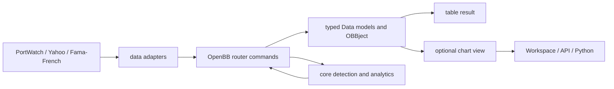

# Charting and command integration

This document describes the product-facing interface for traffic charts, the
event catalog, exposure lookup, historical portfolio stress tests, and the
optimizer. It is intended to let a reviewer understand the chart inputs and
connect the command layer to the analysis and data modules without having to
reverse engineer the plotting code.

## Project boundaries

The extension has three kinds of code:

1. `data/` calls OpenBB providers and returns normalized tables plus source-date
   metadata. Provider calls belong there, not in chart helpers.
2. `core/` implements detection and market calculations using plain Python,
   NumPy, pandas, and SciPy. It should not import the OpenBB application.
3. `router.py`, `models.py`, `charts.py`, and `chokepoints_views.py` turn those
   results into validated OpenBB commands, result tables, and optional charts.

Charts consume result rows. They do not fetch provider data or recalculate
event-study or portfolio analytics. `openbb-charting` and Plotly remain an
optional extra; importing the base package must not import either one.



The chart view receives the same validated result rows as the table. The
route owns scenario selection and warnings; the data layer owns provider calls;
the core owns detection, event-study, stress, and optimization mathematics.

## Routes and data contracts

| Route | Input | Result model | Chart view |
|---|---|---|---|
| `monitor` | Optional chokepoint and vessel type; lookback and threshold | `MonitorData` | Traffic history, robust-normal band, flagged days |
| `events` | Optional chokepoint, type, direction, and source | `EventCatalogData` | Event timeline by chokepoint |
| `exposure` | PortWatch chokepoint key | `ExposureData` | Vessel-share bars and ranked industries |
| `firm_exposure` | Market symbol and optional chokepoint | `FirmExposureData` | Relationship table; no separate chart |
| `event_study` | Symbols, event date, model windows | `EventStudyData` | CAR paths and optional 95% band |
| `stress_test` | Portfolio rows and scenario | `StressTestData` | Holding contributions and historical event outcomes |
| `optimize` | Portfolio rows, scenario, loss limit, objective | `OptimizeData` | Current and proposed weights |

Return values are decimals in result models: `0.047` means 4.7%. Fields that
represent returns or weights carry OpenBB's percent display metadata so
Workspace can render them as percentages. Dates in traffic results retain the
PortWatch observation date; `data_pulled_at` records when the source was read
and `data_through` records the latest observation available.

### PortWatch adapter expected by the commands

The traffic commands use the data-layer function names from the data plan:

```python
get_chokepoint_volume(chokepoints, start, end) -> pandas.DataFrame
get_chokepoint_info() -> pandas.DataFrame
load_events(path=None, *, event_type=None, chokepoint=None,
            min_confidence="low") -> pandas.DataFrame
load_sources(path=None) -> pandas.DataFrame
```

The volume frame is long form with `date`, `chokepoint`, `vessel_type`,
`vessels`, and `capacity_tons`; source metadata is carried in
`DataFrame.attrs`. Info data uses PortWatch's `vessel_count_*` and
`industry_top1` through `industry_top3` fields. The pushed catalog adapter
returns a DataFrame: `id` is the stable event ID, `type` is `disruption` or
`recovery`, and `category` is `blockage`, `conflict`, `climate`, `policy`,
`ceasefire`, or `other`. The command maps these to its public `event_id`,
`direction`, and `event_type` fields. The adapter's `event_type` filter
currently filters the catalog's `type`; the command applies the requested
category filter after loading. `load_sources()` supplies provenance URLs by
event ID. Missing traffic dates must remain missing values, never zero counts.

The monitor consumes `core.detection.compute_scores(series, DetectionParams)`;
the events command uses `detect(series, DetectionParams)` and its episodes for
automatically detected events. The monitor maps `smooth_days=7`, the requested
`baseline_days`, and the requested `tau`. Its normal band is
`baseline_median ± tau × baseline_scale`. The detection helper owns the score
and persistence rule; the command owns OpenBB input validation, display rows,
and source metadata.

The traffic monitor returns dated rows rather than only the latest summary so
the same result supports a readable history chart and a table filtered to its
latest observations. The plotted band is
`baseline_median ± threshold × baseline_scale`, where the core computes
`baseline_scale = max(1.4826 × MAD, 0.05 × baseline_median, 1)`. The provider
loader must preserve missing dates as null values so the rolling calculation
and chart do not invent zero-traffic closures.

The event-study chart uses the committed `run_event_study` function. Each row
contains `ar_by_day`; for a full-window row, `car_var_by_day` contains the
cumulative variance at the matching relative day. The variance is calculated
by the market-model expression already used by the event study, including the
uncertainty in fitted intercept and beta. The chart only converts that value to
a ±1.96 standard-error band.

The stress and optimizer routes are typed to the POST request models in
`models.py`. Their analysis handoff is deliberately kept in `core/`: Manan's
stress calculation accepts a weight vector and an asset-by-event CAR matrix;
the optimizer accepts a current weight vector, a mean or per-event reaction
constraint, and optional covariance/bounds. `core.stress.stress_test` returns
a mapping with `per_event` (event ID to portfolio CAR), `summary` (median,
minimum, maximum, and event count), and `contributions` (holding by event).
That stable return shape keeps the route adapter free of copied portfolio
math. The event rows must be selected by
the same chokepoint, event type, direction, and confidence rules as the event
catalog. Portfolio scenario summaries are calculated per event before taking
the median. Per-holding median contributions explain the result but need not
sum to the portfolio median.

The current date-based market model aligns day zero to the first available
trading day on or after `news_date`. `news_time_utc` is retained in the event
model, but exchange-close adjustment and overlap-cluster estimation are not
implemented in the current event-study core. Those need to be agreed with the
analytics owner before they are presented as supported behavior.

## Chart behavior

### Traffic monitor

The x-axis is the observation date; the y-axis is a seven-day average in
vessels per day. Traces are separated by chokepoint and vessel type. The
shaded band is based on the rolling median and scaled median absolute
deviation, and flags are drawn as separate markers so they remain visible in
grayscale. The subtitle shows `data_through` and `data_pulled_at` when supplied.

### Event catalog

Each event is placed at its `news_date` on a row for its chokepoint. Event type
selects the trace color; direction also selects the marker shape. Recovery
events use hollow circles. Hover text includes the event identifier,
description, direction, and confidence, making clustered or overlapping news
events distinguishable.

### Exposure lookup

Vessel shares are horizontal bars expressed in percent. Industry names appear
as ranked PortWatch entries because the provider does not publish industry
shares. The chart does not imply that an industry rank is a measured market
exposure. Proxy symbols remain in the table for users to pass to the event
study.

### Firm exposure lookup

The firm lookup searches configured route-linked tickers and proxies for the
top ranked sectors at each chokepoint. It returns the relationship reason,
sector, and the core's ordinal sector score when applicable. A route-proxy
match has no numeric score; the sector score is a rank-weighted indicator and
must not be presented as a measured percentage of company revenue or trade.

### Event study

The chart sums daily abnormal returns into a cumulative path, plots one line
per symbol, and marks day zero. If variance is present, the band at day `t` is
`CAR(t) ± 1.96 × sqrt(Var[CAR(t)])`. Missing event-window observations stay
gaps. The result model continues to report decimal returns; the y-axis is in
percent.

### Stress test

Bars show per-holding contributions; points show each historical event's
portfolio CAR. A vertical marker shows the portfolio median. The caption
states the number of events and explains why the holding contribution medians
do not necessarily add to that portfolio median.

### Optimizer

Grouped bars compare original and proposed weights. The caption reports
estimated loss before and after optimization and turnover when those fields
are present. Both bars and the numeric table are shown so the user can read
the result without relying on color.

## Validation and adding a chart

Chart tests use small deterministic result rows. They check labels and units,
day-zero placement, missing-data gaps, recovery marker shape, percent scaling,
and the portfolio summary fields. They do not call PortWatch, Yahoo Finance,
or a live MCP server. Provider behavior belongs in recorded integration
tests; analytical calculations belong in core unit tests.

To add a chart for a new route:

1. Add a typed output model with field descriptions and units.
2. Make the route return an `OBBject` containing those model instances.
3. Add a chart helper that accepts result rows and does no network or core
   calculations.
4. Add a route-named static adapter to `ChokepointsViews` and keep charting
   imports inside the helper or adapter method.
5. Add deterministic tests for the data-to-figure mapping and keep the chart
   useful in light and dark themes.
6. Confirm the base package can import without the charting extra.

## Integration with the main branch

This work is developed on `feature/charting-and-wrappers`. To integrate it,
open a pull request from that branch into `main`, review the generated route
schemas, and merge after CI passes. If the data or analytics branches land
first, rebase this branch on the updated `main` and resolve only the shared
router/model interfaces. Keep provider code in `data/`, detection and portfolio
math in `core/`, and the chart adapters in this product-facing layer.

After any route signature change, install the editable package, run
`openbb-build`, restart Python, and confirm `obb.chokepoints.<route>` appears.
In Workspace, test both the table and chart result, change the chokepoint
selection, and confirm the widgets refresh. The REST schema and examples should
be reviewed alongside the Python call because both are generated from the
same route contract.

## Current integration limits

The feature branch contains the product adapters and market-model event study.
At the latest remote comparison, Anjaneya's PortWatch, event-catalog, detection,
and exposure modules were pushed on separate branches, but had not been merged
into `main` or this checkout. The command wrappers now translate those pushed
interfaces to the public models. Manan's stress and optimizer core modules were
not present on the visible remote branches, so those wrappers follow the
signatures in his implementation plan and remain subject to a contract check
when his core is pushed. Keep all integration work on this product branch until
the owners' changes are merged through the project review process.

## Where team branches connect

The product layer owns the stable command paths, request/result models, chart
helpers, chart adapters, and example entry points. The data and analytics
branches plug into these exact interfaces:

| Owner's code | Expected module/function | Product-layer caller | Shared contract |
|---|---|---|---|
| Data | `data/portwatch.py:get_chokepoint_volume(chokepoints, start, end)` | `router.py:monitor` and `router.py:exposure` | Long-form rows with `date`, `chokepoint`, `vessel_type`, `vessels`, `capacity_tons`; freshness in `DataFrame.attrs`. |
| Data | `data/portwatch.py:get_chokepoint_info()` | `router.py:exposure` | PortWatch rows with `name`/`chokepoint_code`, `vessel_count_*`, and industry rank fields. |
| Exposure | `core/exposure.py:lookup(chokepoint, info, proxies)` | `router.py:firm_exposure` | PortWatch ranks, sector mapping, and proxy lists; the command filters links to the requested symbol and labels route or sector relationships. |
| Data | `data/events.py:load_events(...)` and `load_sources()` | `router.py:events` and `_collect_event_cars` | DataFrame with `id`, `type` (disruption/recovery), `category` (conflict/etc.), `news_date`, `chokepoint`, confidence, and source URLs keyed by ID. The command translates these to its stable output model. |
| Detection | `core/detection.py:compute_scores(series, params)`, `detect(series, params)` | `router.py:monitor` and `events` | Daily score columns (`smoothed`, `baseline_median`, `baseline_scale`, `z`, `yoy`, `flag`) and episode rows (`onset`, `start`, `end`, etc.). |
| Analytics | `core/stress.py:stress_test(weights, car_matrix)` | `router.py:stress_test` | Mapping with `per_event`, `summary`, and per-holding `contributions`, as described above. |
| Analytics | `core/optimize.py:min_change(w0, A, L, bounds)` and `min_variance(cov, A, L, bounds)` | `router.py:optimize` | Proposed weights aligned with input holdings; `A` is mean asset reactions or a matrix with one row per event; the route builds result rows and summary fields. |

To combine the work, merge the data and analytics pull requests into `main`,
then update `feature/charting-and-wrappers` from that new `main` and resolve
interfaces in `router.py` only where their actual signatures differ from this
contract. Keep provider fetching in `data/` and calculations in `core/`; chart
helpers should continue to receive normalized result rows from the output
models. Rebuild with `openbb-build`, then run the command examples and verify
the live charts against the merged provider data before merging the product PR.
